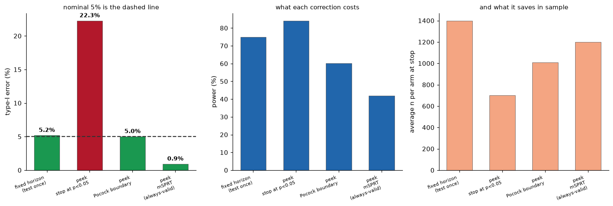
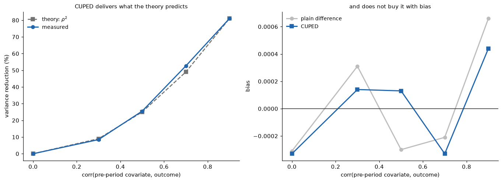
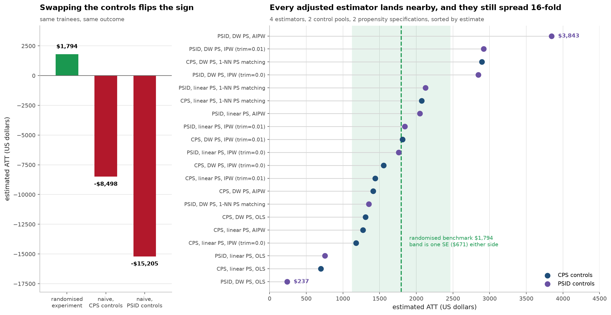
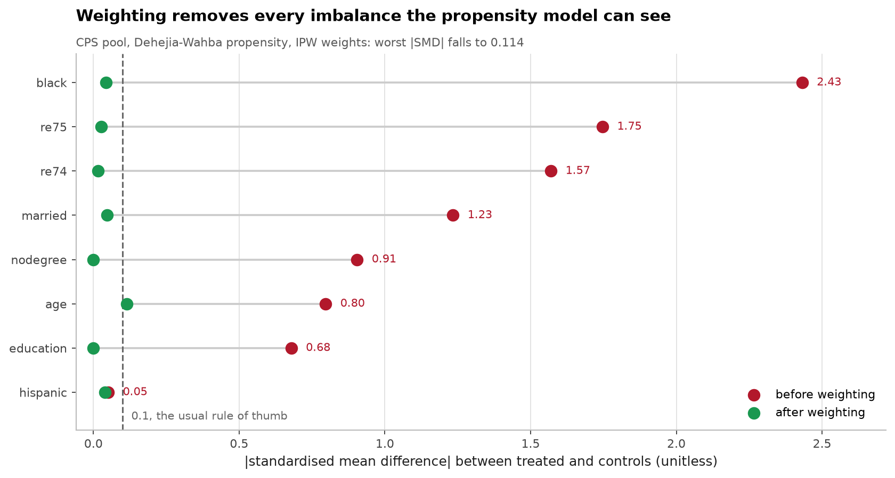
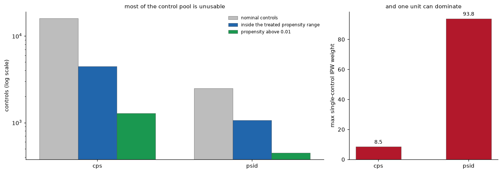

# A/B testing and causal inference, checking the methods against known answers

**[▶ Live demo](https://ab-causal.streamlit.app/)** · analyse a live test with a
threshold that adjusts for how many times you've looked, and an Evidence tab
showing the simulations each rule was scored against.

[](https://github.com/aghasalim/ab-causal/actions/workflows/ci.yml)
[](https://www.python.org/)
[](LICENSE)
[](https://doi.org/10.5281/zenodo.23003606)

I wanted to do a causal inference project, but there's an obvious problem with
them. You can't tell if it worked. With a prediction model you hold out some
labels and check. A causal estimate asks what would have happened otherwise, and
the otherwise never happened, so there's nothing to check it against. That's why I
didn't want to do the usual version, where you run a t-test on a marketing dataset
and report a p-value. It would look the same if the method were completely wrong.

So I only used cases where I already know the true answer. Some are simulations
where I set the effect myself. The other is a well-known dataset where a randomised
experiment already gave the answer. I scored each method against that before I
trusted it anywhere else.

I tried three methods. Below is how each one scored and what it cost.

---

## Does peeking really break a test? Yes, four-fold

I ran 20,000 simulated A/A tests with no real effect, and looked at each one once a
day for 14 days. The fixed-horizon test errs 5.2% of the time. That's about right for
a 5% test, and it's why I believe the next number. If you peek daily and stop at
p<0.05, you turn a nominal 5% test into a 22.3% one.

The two standard corrections bring it back down (Pocock to 5.0%, mSPRT to 0.9%). You
pay for that in power, dropping from 0.750 to 0.601 and 0.419. In percentages that's
power, 75.0% at fixed horizon against 60.1% and 42.0%. So neither one is free. You
give up power to get the smaller sample.



Worked through at length in [notes/METHODS.md](notes/METHODS.md#1-checking-your-test-daily-turns-a-5-error-rate-into-22).

## Does CUPED deliver what the derivation promises? Yes, until you break its one assumption

Here's the measured variance reduction next to the theoretical ρ² (`make cuped`).

| corr(X, Y) | 0.3 | 0.5 | 0.7 | 0.9 |
|---|---|---|---|---|
| measured reduction | 0.085 | 0.255 | 0.526 | 0.810 |
| predicted (ρ²) | 0.09 | 0.25 | 0.49 | 0.81 |

At ρ=0.9 that's 81% less variance. You get the same precision from roughly five
times fewer users, and it stays unbiased the whole way. Since it lines up with theory
across all the correlations I tried, I'm fairly sure the code does what the
derivation says.

The catch is that the covariate has to be measured before randomisation. If
treatment moves the covariate, CUPED subtracts the effect away. I sent all of a true
0.10 effect through the covariate, and the estimate comes back 0.000. Its standard
error stays at 0.019, same as in the column where it's right, so nothing looks
unstable. I think that's about the worst way a variance reduction method can fail.
You get a silent zero with a healthy error bar.



Worked through at length in [notes/METHODS.md](notes/METHODS.md#2-cuped-works-exactly-as-advertised-until-the-covariate-is-downstream-of-treatment).

## Can observational estimators recover a randomised answer? Close enough to fool me

The [LaLonde/NSW](https://users.nber.org/~rdehejia/nswdata.html) job-training
programme was randomised, so we know the true effect. It's **+$1,794** (SE $671).
Having that number is what lets me actually measure things in this section.

First, the failure. The naive difference on observational controls
returns -$8,498 on CPS and -$15,205 on PSID. That's off by more than five times the
effect, and the sign is wrong too.

Adjusting gets you back near the right answer, and that's the trap. I ran regression,
IPW, matching and the doubly-robust estimators and got 20 adjusted estimates. They go
from $237 to $3,843, with the true $1,794 inside that range along with almost
everything else. The closest is IPW on the Dehejia-Wahba specification with
trimming, at $1,812, off by $17. Its bootstrap standard error is $792, so
landing that close was mostly luck. But I could only pick it out because I had the
experimental answer. On real observational data I wouldn't.

The overlap diagnostics show why it's fragile. PSID keeps 1,068 of 2,490
controls inside the treated propensity range, and one control can carry an
IPW weight of 93.8. That's why I report balance and overlap here as preconditions.





Worked through at length in [notes/METHODS.md](notes/METHODS.md#3-every-observational-method-got-close-to-the-right-answer-and-i-could-only-tell-because-i-already-knew-it).

---

## How to run the three studies

```bash
make setup && make experiments
```

This reproduces every number above. You don't need credentials, API keys or paid
data. The simulations are self-contained and LaLonde is public. The code in `verify/`
also recomputes every published number on its own, and CI fails the build if any of
them disagree.

```bash
make test
```

15 tests. I wrote them to check the results themselves, not only that the code runs.
The fixed-horizon test has to actually hit 5%, and peeking has to actually inflate it.
The calibrated boundary has to restore control on a seed it wasn't calibrated on.
CUPED on a mediator has to erase the effect. And IPW, AIPW and matching have to
recover a known effect on confounded synthetic data where the naive difference
doesn't. The bootstrap standard errors have to match the real spread of the
estimate over fresh samples. If a refactor quietly broke a headline result, these would fail.

```bash
make app
```

This opens an analyser with the checks I'd want on a live test. It flags
sample-ratio mismatch and adjusts the significance threshold for how many times
you've looked. There's also an MDE calculator, so you can see whether an experiment
can answer its question before you run it.

## Why the simulator comes first

I score every decision rule on `simulate.py` before it touches real data.
`simulate_looks` returns the z-statistic at every interim look, and all the rules
read that same matrix. So the comparisons are paired. Naive peeking and the
corrected boundary see byte-identical experiments, which means the differences
between them aren't simulation noise.

Worked through at length in [notes/METHODS.md](notes/METHODS.md#3-design-notes).

## What lives where

```
src/abcausal/
  simulate.py       simulation harness, truth is known by construction
  sequential.py     fixed-horizon, naive peeking, Pocock, mSPRT
  cuped.py          variance reduction, and how it breaks
  observational.py  OLS, IPW, matching, AIPW, balance and overlap diagnostics
  diagnostics.py    SRM, MDE, required sample size
  experiments/      the three runnable studies above
app/                Streamlit analyser
tests/              15 tests asserting the claims
```

It's MIT licensed, see [LICENSE](LICENSE). The LaLonde data is public, thanks to
Rajeev Dehejia and NBER.

## Where the three methods come from

Deng, Xu, Kohavi, Walker. Improving the Sensitivity of Online Controlled Experiments by Utilizing Pre-Experiment Data. WSDM 2013. CUPED, the variance reduction implemented here.

Rosenbaum, Rubin. The Central Role of the Propensity Score in Observational Studies for Causal Effects. Biometrika 70, 1983. propensity scores.

Kohavi, Tang, Xu. Trustworthy Online Controlled Experiments. Cambridge University Press, 2020. the experiment design practices the harness checks.
